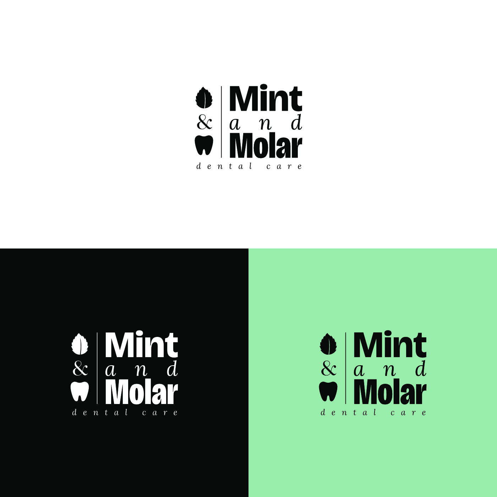
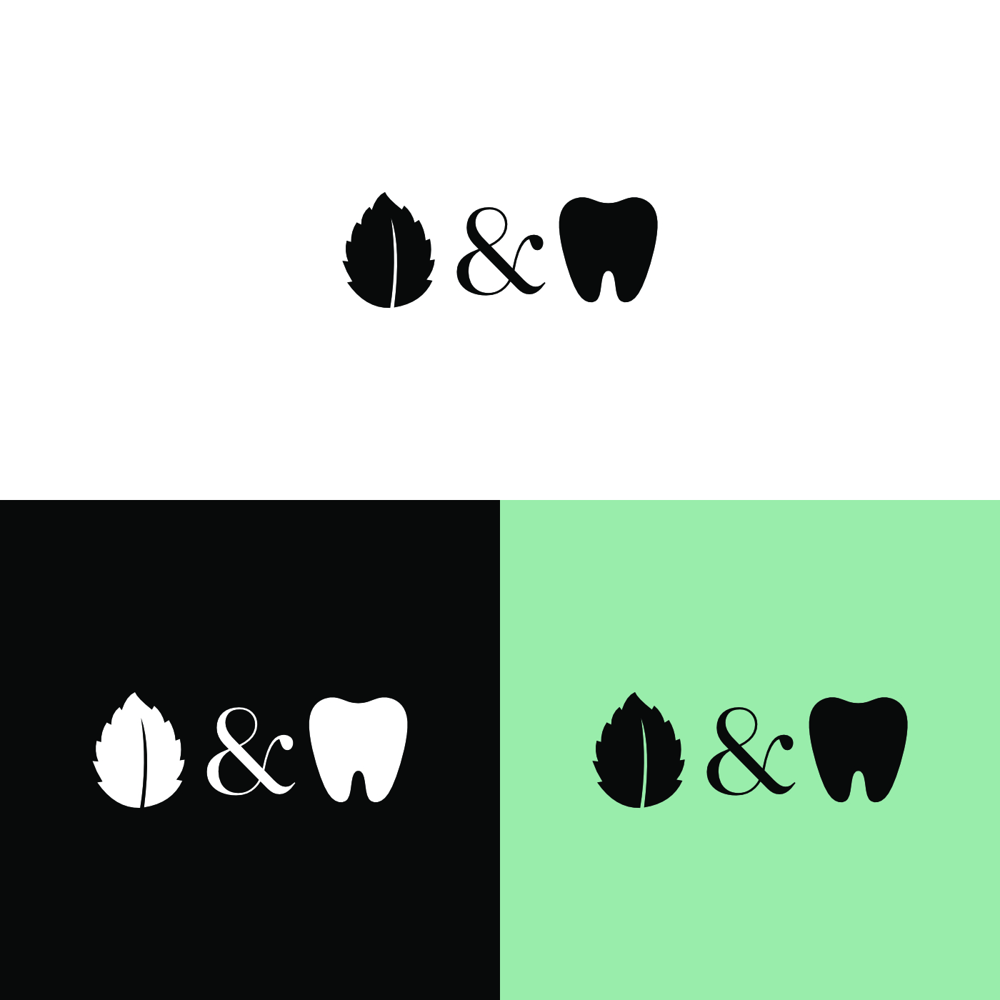
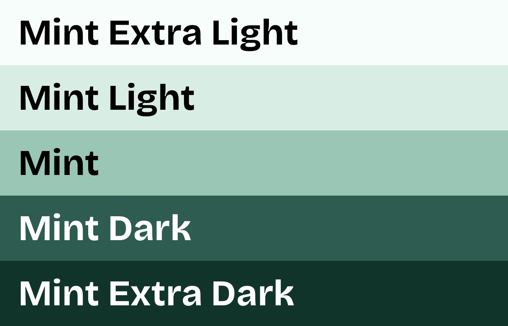
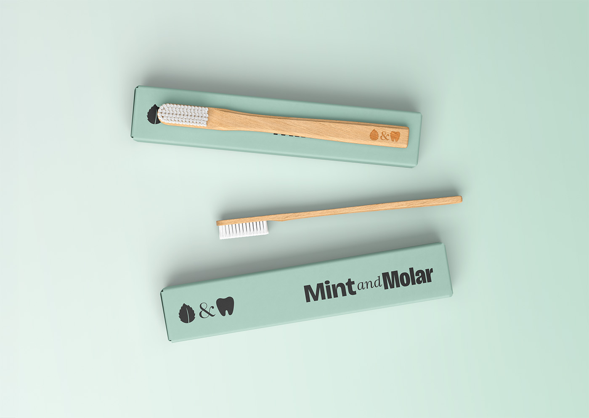
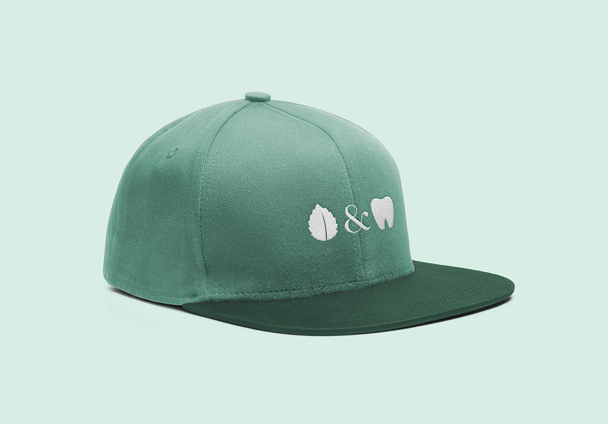
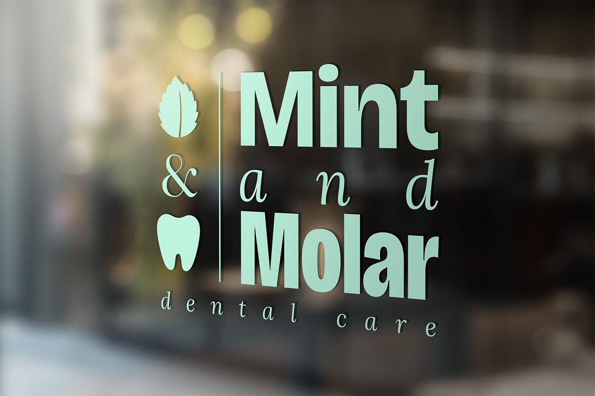

{:.post-callout-medium}
A fresh, unhurried identity for a family dental practice

A new name deserves a new look. Mint & Molar's promise is simple: no-pressure, family-first care explained in plain English. For this Frederick, Maryland dental practice, I created an identity that gives that promise a face, one as fresh, unhurried and easy to trust as the care itself. See it in action at .

<!-- TODO: link to the Mint & Molar web design project once it's added -->

  

    
  

  

    
  

The name does the heavy lifting, so the mark simply illustrates it: a mint leaf and a molar joined by a serif ampersand. The leaf signals freshness and the tooth keeps it clearly dental, while the ampersand's softer, classic character adds warmth to what could otherwise feel clinical. Each piece also works on its own, so the icon can stand alone on small items like a toothbrush or a favicon.

  

    
  

Rather than the bright blues common to dental brands, the palette stays in a single family of greens, from Mint Extra Light to Mint Extra Dark. The lighter tones keep things airy and clean, while the darker ones anchor text and signage with a grounded, trustworthy feel. Naming each step after the brand keeps the system simple to use across print and web.

  

    
  

  

    
  

  

    
  

Put to work, the identity carries through the details a patient touches and sees, from the toothbrush and branded caps to the sign in the office window.
